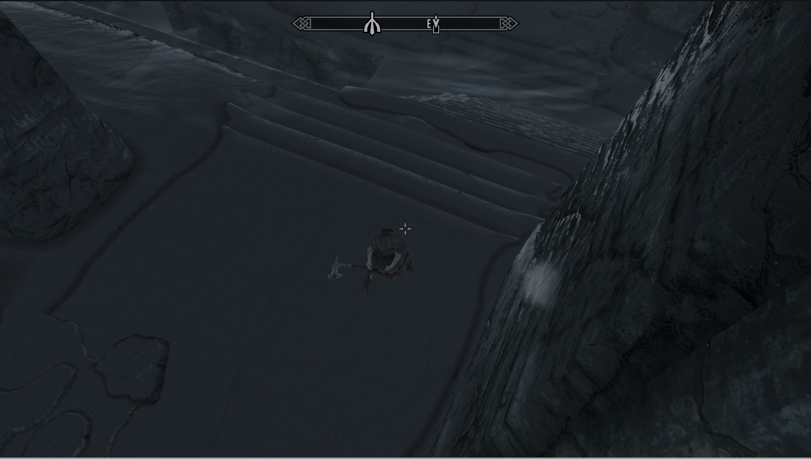

# DYL-156 / P2-01 — Camera controls candidate

2026-10-26. Original module source/configuration/docs copyright devils_17, MIT.
Implementation base `887f1855cefbd51baa07862398826c16d4eaceba` (accepted PR6), shared build integration `e7f141f6b92b1305695d4f744c48ab438e8e0803`; initial native implementation `0a92db1`, guarded controller source `cea821d8ef1ebcb8a9202a47ffb5a3d1bb1e7925`. [Exact controller-source hashes](camera-controls-audit/candidate-source-hashes.json) identify this candidate. Native build/package and candidate upload PASS on [run 40381045722](https://github.com/Sonoran-Solutions/SkyCRPG/actions/runs/40381045722), source `8a681390db5b36c2b6fb4fcb056c0abc0e085a35`; that run failed only in later diagnostics upload. The corrected whole Camera-only workflow subsequently passed [run 40385191497](https://github.com/Sonoran-Solutions/SkyCRPG/actions/runs/40385191497), exact source `37008f2efc9850c057149f42c1e16bdce1da7d1e`, including the narrowed diagnostics upload. [Exact native CI/artifact record](camera-controls-audit/native-ci.json) preserves both outcomes. **Runtime acceptance: PASS for the owner-observed bounded Camera-only controls route 20261026T115627.** No game launch, deployment, save/Proton changes or process manipulation was performed by this worker.

[Linear DYL-156](https://linear.app/devils17/issue/DYL-156) was read with full description, blocking relations and comments (none); state at assignment Backlog, dependency DYL-155 satisfied by the accepted gate. The Linear shared-notes tool was attempted and returned “Tool get_agent_context not found”; repository contracts and actual source were used. No downstream ticket was started.

## Actual integration mechanism

SmoothCam 1.8.1 remains the sole normal third-person transform writer and collision implementation. TDM 2.3.1 remains movement only. The original preset still supplies elevated offsets and provider smoothing. SkyCRPG adds an original native **input policy**; it does not write player angles, camera matrices/quaternions, native `freeRotation`, camera positions, `currentZoomOffset` or collision results.

The pinned SmoothCam V1–V3 public API was inspected first. It exposes exclusive camera/crosshair/stealth ownership, position observations, interpolator controls, enabled observation and horse aim. It has no pitch setter or policy callback. Its pitch-zoom configuration changes distance based on pitch and cannot hold a chosen angle. Requesting exclusive camera ownership would stop provider transforms and require a different collision/controller route; that route was not adopted.

A bounded read-only audit of the actual Steam executable established a smaller compatible path. [Mapping/hashes](camera-controls-audit/native-mapping.json) pins executable SHA-256 `846efccf0c1374d71f892907f46549560f2fcb0a75cb87a3eed438baa0f1402f` and Address Library13 database SHA-256 `8aab3dd251d135b849bd983f86a4a205c920fa3e81f8e30c0e63ccfef9423842`. Proprietary executable bytes/disassembly remain external; none are distributed here.

| Verified surface | Static finding / implementation |
| --- | --- |
| Address Library AE ID205236 | ThirdPersonState primary vtable RVA `0x18ecc08`; slot3 native Update RVA `0x8fd590`, slot15 native HandleLookInput RVA `0x8feb00`. |
| Native Update | Calls virtual HandleLookInput before rotation computation, including an idle frame's zero vector. Native handler receives one vector; no duplicate native action is injected. |
| Native look semantics | With free rotation enabled, increments native yaw/pitch input by `input * fFreeRotationSpeed:Camera * frameDelta`. Default gain3.0; read live by native named INI setting, never overwrite it. Frame delta uses Address Library AE ID410200, RVA `0x327560c`; ID410199 is a different time value and is not substituted. |
| Native rotation computation | Pitch reads actor pitch minus native freeRotation.y; heading reads actor yaw plus freeRotation.x. This permits bounded requested pitch/yaw errors to be expressed through the native input vector without assigning rotations. |
| SmoothCam hooks | `source/hooks.cpp` hooks native Update and HandleLookInput; its Update chains native first, then calls provider UpdateCamera. Its look hook respects provider input locks then chains original. SkyCRPG installs at DataLoaded only when slots3/15 exactly match native Address Library IDs50896/50914. SmoothCam defers its wrappers to NewGame/PostLoadGame, so the chain must be SmoothCam → SkyCRPG → native. The inner update clamps the native zoom request after native Update and before the outer provider transform. Both active slot pointers must belong to the exact-hash SmoothCam module on each policy evaluation; changed order/owner leaves policy inert. Repeated DataLoaded cannot hook itself/register sinks twice. The bounded runtime route passes held framing/controls with provider initialization and module hook logs present. Full interrupted/conflicting-hook ownership coverage remains NOT_RUN; no instrumented per-frame trace is claimed. |
| Requested zoom | SmoothCam `GetCameraZoomScalar` reads native `targetZoomOffset`, then its own interpolation/collision writes final camera position. SkyCRPG sets only this requested scalar once on eligible preference application, then bounds native requests in its inner native Update wrapper. Controller POV-slide zoom bypasses HandleLookInput; this update path also bounds that gesture. Native stateNotActive/POV transitions suspend both pitch policy and zoom clamping. It never writes the current/interpolated distance or collision result. |
| CommonLib hazard avoided | Native primary table ends after slot15; slot16 points to the following RTTI data on this exact executable. CommonLib's declared virtual UpdateTranslation is therefore not called or hooked. |
| TDM movement | Existing source rotates keyboard/stick direction relative to camera heading; SkyCRPG does not synthesize movement/combat. TDM API V5 RequestDisableTargetLock actually calls SetForceDisableTargetLock(true), despite its header's misleading reticle wording. A process-lifetime disable lease is required; failed lease or active lock suspends policy. Native first/special states remain native. |

Source pins: SmoothCam `e0afd09aff26e5849dac461252e5bffbd5b69d62`, TDM `57b913ae17fed857c9e281799174898cd66a3e82`, CommonLibSSE-NG7.2.0 `7a60f4de794095d7b0f8928d1b930a52e9a7da83`. [Exact input-file hashes](camera-controls-audit/source-inputs.json) preserve the audit inputs. Public API headers are permitted API-consumer copies; [local notice](../../../modules/camera/include/third_party/NOTICE.md) distinguishes them from original MIT work and includes TDM's upstream license/exceptions. No provider implementation or binary is copied.

## Exact runtime member-layout audit

The [bounded follow-up audit](camera-controls-audit/layout-audit-job.json) independently compared every camera member used with exact1.7.104 instructions; [offset equality table](camera-controls-audit/layout-offsets.json) records each address and scope. `targetZoomOffset=0x74`, `freeRotation.x/y=0xD4/0xD8`, `freeRotationEnabled=0xDC` and `stateNotActive=0xDD` match the selected CommonLib declarations. Native Begin clears0xDD, and the native translation body tests it before the first-person transition. The adjacent0xDE flag has separate behavior and is not confused with0xDD. Compile-time offset assertions lock the audited fields.

PlayerControls has **no versioned runtime accessor** in this CommonLib release. Independently verified direct fields are `data=0x24`, POV-slide `0x4B`, and two POV-inhibit bytes `0x4C/0x4D` (declared script/beast). Native helper RVA0x7AE030 requires native POV control bit5 enabled and both inhibit bytes clear; native reset clears the word at0x4C. These bytes are not inferred from a structure name or treated as broad lifecycle proof.

A concrete unsafe assumption was corrected: `blockPlayerInput` is declared at0x1D9 but has no substantiated PlayerControls native access in this audit. Constructor/dispatch/menu paths initialize or use0x1D8 and0x1DC; matched0x1D9 boolean accesses belonged to another class. The module **no longer reads0x1D9**. This does not establish that all library fields are wrong or prove the byte is always padding.

The replacement guard reads native ControlMap looking/POV enabled flags through its versioned accessor. For this exact runtime, accessor base0xF0 plus enabledControls member0x30 equals native offset0x120. Exact native getter RVA0xA25230 reads the same singleton/address and bit1 for looking; ToggleControls RVA0xCEFAA0 updates the same mask; the native POV helper uses bit5. Disabled native look/POV controls now suspend custom policy, preserving scripted input disable without an unverified padding read. No proprietary disassembly bytes are committed. The member assertions compiled in run 40381045722; the later bounded runtime controls route passes. The member-offset equality itself remains static evidence, not complete lifecycle proof.

## Preferences, states and controls

Preferences live only in `Data/SKSE/Plugins/SkyCRPG_Camera.ini`, schema1. Default pitch55°, bounded15–75°; native requested zoom default0.65, minimum0.25, maximum0.90. Pitch convergence is bounded at90°/s, yaw recenter180°/s. Unknown schema suspends custom policy and is never overwritten. Missing/malformed numeric text uses that field's default; nonfinite floats use defaults clamped inside the already-validated dependent bounds; finite outliers clamp. A minimum zoom above the ordinary default maximum cannot create an inverted range. Only numeric1 enables the bEnabled flag; other numeric values safely disable. Custom keys reject F8 and map K/L, invalid values and duplicate bindings; native gameplay-mapped inputs are also refused at dispatch. Native mouse/right-stick input keeps its own sensitivity/axis behavior; held pitch replaces the vertical request. The bounded mouse/controller route below is owner-accepted; inversion variants and the full controller/context matrix remain NOT_RUN.

Initial startup, successful load notification and deliberate F6 re-enable mark a zoom preference application pending; only an eligible normal third-person frame applies it. Thereafter wheel/native zoom requests are bounded and remembered. Enabled/zoom preferences are persisted when explicitly toggling or on a native SaveGame notification; this stores no game-save data, pointer, effective state or target. Writes preserve unrelated INI sections/keys and report failures. Full lifecycle persistence/atomic migration remains DYL-159. No new persistent store or co-save exists.

Precedence foundation is tested as disable/invalid prerequisites → invalid world/loading/death → special/scripted → focused menu/dialogue → first person → precision → targeting → obstruction → normal. Runtime guards require a live player/cell/3D/camera, native normal third person/free rotation, no swimming/mount/killmove/script/beast/native POV transition, no native focus/pause/cursor/modal menu, current enabled SmoothCam with no external camera owner, verified outer hook chain, exact supported files and TDM lock disabled. Executable/Address Library hashes are checked before CommonLib address initialization; absent/incompatible files leave this module inert instead of invoking the library’s fatal missing-address path. Native POV-slide zoom permits only the requested-zoom clamp, suppressing custom pitch/input/Force POV. Aim/obstruction intervention flags are narrow future inputs and are not claimed as implemented DYL-157/158 behavior. Native POV remains the precision fallback; overhead ranged aim is still FAIL in Phase1.

TDM camera yaw must be0 in its effective config. The module checks provider `Data/MCM/Config/TrueDirectionalMovement/settings.ini`, then the user override `Data/MCM/Settings/TrueDirectionalMovement.ini`, at DataLoaded and native menu events; malformed/absent/competing yaw values suspend custom policy. This matches the inspected provider read order and performs no provider-settings writes. The integrator must merge the existing Camera fragment and preserve the owner's settings, including compare-and-restore ownership. The V5 disable-target-lock lease does not disable movement.

| Action | Actual candidate mapping / safety |
| --- | --- |
| Native normal first-person view / explicit return | F6/DirectInput64. From eligible enabled third person: suspend policy and request native first person. A second F6 returns only from the first-person request owned by that toggle. Deliberate native POV first person is never automatically reclaimed. If policy was disabled in eligible third person, F6 enables it without forcing a camera state. |
| Native underlying third-person emergency | Existing SmoothCam F8/scan66 stays unchanged and independently reachable. SkyCRPG never re-enables SmoothCam, and suspends while provider-disabled. This is the demonstrated Phase1 emergency path, not a claimed global reset. |
| Yaw | Native mouse horizontal / controller right-stick horizontal, through one native/provider chain. |
| Hold pitch | Configured angle converges through filtered native look input; vertical look does not drift it in eligible overhead mode. |
| Recenter | F7/scan65 requests bounded native yaw error toward current player heading. No actor movement/rotation assignment. |
| Zoom | Native wheel / native controller zoom gesture; request bounded by the INI limits. Provider collision can bring the actual camera closer, regardless of requested minimum. Native POV remains available. |
| Controller custom toggle/recenter | `iToggleGamepad` / `iRecenterGamepad` single native bit masks, default-1/unbound. Native-mapped buttons are rejected. No unverified chord or stolen native gameplay button is selected; custom mapping acceptance remains NOT_RUN. |
| Precision / movement / combat / activation | Existing native POV, keyboard movement, left stick, attacks, spells and activation remain engine/TDM-owned; no replay or synthetic action. |

Input is observed without consuming native events or injecting buttons. Custom bindings operate only on unmapped keys and fresh native down edges. Keys already held across focus suspend until release; an idle key's first clean press after load works without a sacrificial press. Menu/load invalidation cancels recenter; loads and observed deliberate native Toggle POV input cancel F6-owned restoration permission. No automatic return over native first person occurs.

## Validation and remaining gate

| Check | Result / scope |
| --- | --- |
| Exact-source API/native executable audit | PASS (static), [bounded job](camera-controls-audit/native-audit-job.json), mapping/input hashes above. This established numeric semantics; it is not a game control test. |
| Focused native policy tests | PASS, [job](camera-controls-audit/policy-test-job.json), [log](camera-controls-audit/policy-test.log). g++ C++20 warnings-as-errors; nonfinite/default/clamp handling, reserved/duplicate bindings, precedence, native-view safety, held/fresh focus edges, shortest yaw and time-bounded input correction. |
| Evidence links/JSON/input and candidate source hashes | PASS, [bounded check](camera-controls-audit/evidence-check-job.json) and [report](camera-controls-audit/evidence-check.log). |
| Nonfinite dependent zoom defaults | FAIL found by root source review: min0.95/maxNaN could leave max0.90 and violate std::clamp precondition. Corrected fallback clamping; PASS portable regression for all nine NaN/positive-infinity/negative-infinity max+zoom pairs at min0.95. The corrected source compiled in run 40381045722; nonfinite-config gameplay recovery remains NOT_RUN. |
| Initial Camera Windows x64 build | FAIL retained: [run 40375266551](https://github.com/Sonoran-Solutions/SkyCRPG/actions/runs/40375266551), absent SDK symbolic1.7.104 constant and cascading constinit error. [Original diagnosis/log hash](camera-controls-audit/initial-ci.json). Corrected using explicit constexpr REL::Version{1,7,104,0}. |
| Final Camera Windows x64 build/package/upload | PASS: [run 40381045722](https://github.com/Sonoran-Solutions/SkyCRPG/actions/runs/40381045722), source 8a68139, including runtime-value/member-layout/fallback corrections. [Native CI/package hashes](camera-controls-audit/native-ci.json). |
| Downloaded final candidate integrity | PASS: [bounded hash check](camera-controls-audit/artifact-check-job.json) verified the package archive and all five payload member hashes without extraction. [Report](camera-controls-audit/artifact-check.log). |
| Whole CI workflow / diagnostics | PASS [run 40385191497](https://github.com/Sonoran-Solutions/SkyCRPG/actions/runs/40385191497), exact source 37008f2efc9850c057149f42c1e16bdce1da7d1e: native build/package and both candidate/diagnostics uploads succeeded. Workflow-only fix 7ad3396 selects exact paths. Earlier run 40381045722 diagnostics-only symlink/EPERM FAIL remains historical in native-ci.json. Runtime proof still belongs to the owner-tested 8a68139 artifact; combined runtime remains open. |
| Camera-only exterior controls | PASS owner-observed run 20261026T115627: stable elevated pitch and camera-relative walking/running, mouse yaw/zoom limits, F7 recenter, F6 native first-person fallback/deliberate return, inventory/menu focus without duplicate actions. [Owner record](camera-controls-runtime/owner-observation.json), [bounded job](camera-controls-runtime/job.json), [run result](camera-controls-runtime/run-summary.json). |
| Native controller / custom controller bindings | PASS owner-observed movement and camera yaw after one unchanged relaunch. Initial recognition FAIL retained with causal root unknown. Custom toggle/recenter remain unbound; custom mappings and separately reported controller zoom/POV gesture coverage remain NOT_RUN. |
| C2 obstruction / C3 overhead ranged aim / C4–C5 lifecycle | Unchanged: bounded Phase1 obstruction/first-person precision/F8 proof reused; overhead ranged aim FAIL and load pitch FAIL retained. Broader DYL-157/158/159 cases NOT_RUN. |

Integrator reproduction: build Camera only using pinned shared dependency wiring; hash DLL/INI/provider inputs and package, record source and exact runtime. Stage the Camera fragment into the effective TDM config with competing yaw/lock off. Use the accepted Steam1.7.104/SKSE2.3.1/Address Library13 + SmoothCam1.8.1/TDM2.3.1/MCMHelper1.6.3/SkyUI6.11 on Ubuntu26.04.1, Proton Experimental11 `experimental-11.0-20261014-x86_64`, RTX3080, 1080p and copied Helgen exterior fixture. One orchestrator-owned route, max20min, no parallel game/build/GPU job: verify initial framing settles; walk/run/sprint and native yaw; both zoom bounds without collision bypass; F7 recenter; F6 native first-person and deliberate return; native POV precision remains owned; F8 disable blocks custom correction until explicit F8 re-enable. Open inventory/dialogue/console while controls held; confirm no action behind focus or held replay on close, and first fresh press works. Edit malformed/unknown-schema settings with game closed and verify native/default recovery. Record exact per-step PASS/FAIL, captures/owner observation, logs and cleanup. Do not claim DYL-157/158/159 completion from this route.

Proposed `docs/CONTROLS.md` Camera section is the actual candidate mapping table above; the orchestrator owns that shared-document integration. The initial native CI failure is retained. Source 8a68139 now has native build/package/upload PASS; its earlier diagnostics-only failure remains explicit, and the complete Camera-only workflow/diagnostics correction now passes on exact source 37008f2 in run 40385191497. The owner-tested runtime artifact remains 8a68139; the workflow-verification rebuild is not substituted as gameplay evidence. The bounded Camera-only exterior controls route is now owner-accepted PASS; broader gameplay and acceptance remain explicitly open. Native Windows gameplay, other executable/provider builds, full controller/layout/lifecycle/performance and public release remain NOT_RUN. Runtime hardening/restoration beyond this guarded input-policy foundation belongs to DYL-159; no owner defer is expanded.

## Compiled candidate identity

The downloaded candidate is `SkyCRPG_Camera-0.0.1-8a68139.zip`, SHA-256 `50a23e3b768ff0d5a949b88b0f97f25787f64b2155d42da675338773e7309e76`. Its native DLL SHA-256 is `aedc9d53e7c7d85719fb600fe8b71129cc9aab1f67f92cffe10ea499f106d024`; packaged INI SHA-256 is `a1b566ac5d4d439114eb6f168c5bf6984556c527e5d211deb6a6eb8047560afc`. The package manifest pins all five members, including CommonLib license/exceptions and build-input notices; metadata and log hashes are in [native-ci.json](camera-controls-audit/native-ci.json). GitHub's outer uploaded-artifact ZIP digest is separately identified there and is not the mod package digest. No DLL, source-build tree, ZIP or provider binary is committed by this evidence update.

## Bounded runtime acceptance — 2026-10-26

The owner accepted the final Camera-only checklist on the exact source 8a68139/DLL `aedc9d53e7c7d85719fb600fe8b71129cc9aab1f67f92cffe10ea499f106d024` candidate:

> It looks good, everything you asked me to check passes and functions how I would want it to.

The [recorded checklist](camera-controls-runtime/owner-observation.json) covers exterior walking/running with stable elevated pitch and camera-relative movement, mouse yaw and zoom limits, F7 recenter, F6 first-person fallback and deliberate return, inventory/menu focus without duplicate actions, and native controller movement/camera yaw. This is owner acceptance of those controls, not a complete Camera MVP or Phase2 gate. [Exact runtime inputs](camera-controls-runtime/runtime-inputs.json) pin the deployed module/providers and source evidence hashes. Native Camera-only uses ordinary UI; no UI adapter behavior is inferred.

Initial route 20261026T115252 **FAIL**: the owner reported controller input was not recognized and requested one diagnostic relaunch. [Original observation](camera-controls-runtime/initial-controller-failure.json) is retained. Linux detected the controller and gamepad enable was set; that does not establish why the game initially ignored it. The same candidate relaunched once as 20261026T115627, then the owner reported **PASS**. No code change, causal fix or general controller reliability proof is claimed. The successful run exited normally at 12:04:03 Phoenix, before its 20-minute deadline, with no recorded load problems or leftover processes. [Job](camera-controls-runtime/job.json) and [run summary](camera-controls-runtime/run-summary.json) preserve handles, deadline, result and original log hashes.

The capture SHA-256 is `1818e257c8add8fed58d0699d321575ba4be260ffb3603ec5fc8c6a008c3d92f`. It corroborates elevated framing/location; dynamic behavior comes from the explicit owner checklist. The PNG is 1913x1083, not a separate resolution acceptance test. Before/context references: [Phase1 native exterior baseline](../p1/captures/baseline-20261026-exterior.png) and [Phase1 overhead combined capture](../p1/captures/combined-20261026-topdown-minimap.png). These differ in scene/profile and are not a controlled visual/performance comparison.

Concise unmodified logs: [Camera](camera-controls-runtime/logs/SkyCRPG_Camera.log), [SmoothCam](camera-controls-runtime/logs/SmoothCam.log), [TDM](camera-controls-runtime/logs/TrueDirectionalMovement.log) and [MCM Helper](camera-controls-runtime/logs/MCMHelper.log). Camera identifies source 8a68139 and the pinned runtime; SmoothCam records the consumer/deferred initialization and TDM supplies the API singleton. Missing optional integrations and existing MCM keybind/MergeMapper diagnostics remain visible; the passing owner route does not certify those integrations. Raw log bytes/CRLF are preserved for exact hashes. Full loader/game/telemetry logs remain external, with their source hashes in the committed job/input records.

Camera cleanup/restoration **PASS**: original configuration and before-inventory equality were verified by the orchestrator, with no mismatches or leftover Camera game processes at that cleanup. This is a recorded snapshot; UI-only was deployed afterwards. Owned Camera INI preferences changed during testing and were preserved before restoration. The owner requested retaining the character: 20 save/co-save files were backed up locally and hash-verified, and the latest manual/exterior checkpoint pairs were added to isolated Camera fixtures. [Privacy-preserving preservation summary](camera-controls-runtime/preservation-summary.json) retains counts, timestamps and manifest/restoration hashes. Save bytes, character identifiers, personal names and save filenames are excluded from Git.

Still open: full obstruction/collision DYL-157; overhead ranged aiming **FAIL**/DYL-158; historical load-transition pitch **FAIL**, repair/full lifecycle and restoration DYL-159 **NOT_RUN**; fresh global emergency/reset/special-state matrix; malformed-config runtime routes; additional controller mappings/contexts; native Windows/other runtime/profile combinations; combined changed-module regression; and performance. Existing Phase1 precision/F8/obstruction proofs retain their original bounded scope. This route does not relabel any of those obligations PASS.
