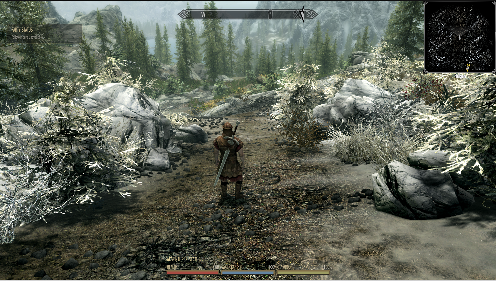
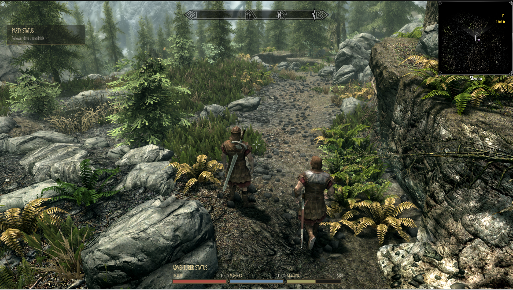

# DYL-160 — core CRPG HUD evidence

## UI-only live resource acceptance and bounded percentage spacing follow-up

**Route 3 PASS — bounded UI-only ordinary-camera resources/layout and owner-confirmed menu round trip.** All three meters are visible in the owner's paired 1080p captures. Sprint changes stamina from100% to53%; health/magicka display100%. The owner explicitly confirmed menu open/close without duplicated elements in a subsequent message relayed by the integrator. [Original sprint report](core-hud/runtime-route-3-owner.json), [bounded menu confirmation](core-hud/runtime-route-3-menu.json), [UI log](core-hud/runtime-route-3-ui.log) and [global-coordinate log](core-hud/runtime-route-3-geometry.log) preserve the evidence. This proves this bounded resource backend/positioning route; it does not establish individual health/magicka depletion, full menu/controller lifecycle, scale/reset or combined acceptance. Both earlier FAIL routes remain below. Root owns game exit and restoration.

Exact tested native source `e49fc30aebb008377e9a010e96757444c0f684c6`, DLL SHA-256 **`29381c08436486fda835206dceebaac73b1902f7f13af9a3f8d25b070d6fe136`**; tested SWF source `e2128ab887f961318614fb7a12f2b1ca765dcd82`, SHA-256 **`eef2936eae0da412ad46f24ff929a1841b2a0c149660cc35750d2de3290700ac`**. The two screenshots below are original copied bytes, with no edits: before SHA-256 `470e4f901a78ec2a2ed759f81c55f88580c1d6e7ee46800ec7f174af36c67553`; after `07fdeecf794b247c9e250d3a74b00216872858ade82badec035cad5099795cbc`.

A small visible spacing defect remains in those tested captures: the percentage field's nominal right edge was144px while the next label begins142px from the prior meter origin. The new AS2-only follow-up moves the field fromx112 to104, so right-aligned text ends at136px, matching its bar and leaving6px before the next label. Native code and resource/coordinate behavior are unchanged. [Focused harness PASS](core-hud/spacing-harness.log), [job](core-hud/spacing-job.json), checks the136px edge/6px gap along with the existing contracts. HUD-only build **PASS / COMPILED_NOT_RUN**, PID195628, 0.820s, 512MiB heap/600s limit: [manifest](core-hud/spacing-build.json), [log](core-hud/spacing-build.log). Latest SWF SHA-256 **`b4552e17f0806848bcbb0a31f09e934e3feffc5a405305ba5707beb6b3215c05`**, `/srv/storage/Projects/SkyCRPG/session-p2-20261026/ui-hud-spacing-candidate-20261026/Data/Interface/hudmenu.swf`.

The new spacing SWF has **NOT_RUN** gameplay status. Reuse the exact tested `e49fc30` DLL and the prior live backend/coordinate proofs explicitly; the integrator will validate the new spacing movie in the combined smoke. This worker performed no native build, deploy, push or Skyrim launch.

## Coordinate correction after second failed runtime route

**Route 2 FAIL; resource snapshot path PASS; corrected positioning runtime NOT_RUN.** The owner still could not see resource meters; the party panel appeared near bottom center. [Owner observation](core-hud/runtime-route-2-owner.json), [native UI log](core-hud/runtime-route-2-ui.log), [AS geometry](core-hud/runtime-route-2-geometry.log) and [restoration](core-hud/runtime-route-2-restoration.json) preserve the failure. Logs prove a valid current/max snapshot (`H100/100 M100/100 S90.626/100`) and `first-valid-render` with modeVisible=true. The Stage was 1280×720, but HUDMenu was translated to 616.65,475.45; assigning Stage anchor 430,656 directly as local panel coordinates placed it below the viewport. The screenshot remains external in `ui-route-2/owner-missing-meters.png`, SHA-256 `b626ab1a079cc9484a646c09cdb6628a386c8acd5ec594bc57bde2cd32d52081`. Geometry is the confirmed cause for route 2 and could also explain route 1. The original callback gate remains a source-level unreliable initial-data contract; without callback traces it is not proven to have caused route 1.

The AS2 correction converts each intended global Stage anchor through HUDMenu.globalToLocal. A second converted 100px extent compensates ancestor scale so the panel retains its configured Stage size. Both resource and party panels use the conversion. The bounded geometry log now also reports actual global panel position. Native source remains `e49fc30`; reuse its exact DLL. No native rebuild, gameplay/input changes or deploy was performed by this worker.

[Harness PASS](core-hud/coordinates-harness.log), [job](core-hud/coordinates-job.json): tests now compute actual global panel bounds with the recorded 616.65,475.45 origin, nonunit X/Y scale and nested translated/scaled ancestors, at 720p/1080p and settings 85/100/115%. They check final anchors, size and viewport bounds in addition to all resource/fallback/mode/teardown cases. An initial local test caught a scale normalization error, corrected before compilation; failed local job/log remain external in `ui-resource-validation/coordinates-initial-*`.

HUD-only FFDec compilation **PASS / COMPILED_NOT_RUN**; PID 192265, 0.816s, 512MiB heap, 600s timeout. Latest SWF SHA-256 **`eef2936eae0da412ad46f24ff929a1841b2a0c149660cc35750d2de3290700ac`**, `/srv/storage/Projects/SkyCRPG/session-p2-20261026/ui-hud-coordinates-candidate-20261026/Data/Interface/hudmenu.swf`; [manifest](core-hud/coordinates-build.json), [log](core-hud/coordinates-build.log). [Static bytecode export PASS](core-hud/coordinates-export-verification.json), [export job](core-hud/coordinates-export-job.json), verifies both converted anchors/scales and global geometry diagnostics in the compiled movie. Initial inspection expected original local variable names; FFDec renames them, so inspection was corrected to verify the emitted conversion structure without rerunning compilation. Native DLL, exported third-party source and proprietary SWFs remain outside Git. Actual corrected UI-only/combined gameplay is still open.

## Geometry diagnostics candidate

AS2-only follow-up to native source `e49fc30`: the existing `skse.Log(string)` API is verified in pinned SKSE `Hooks_Scaleform.cpp269–280` and registered at line1559. Each created panel emits one setup geometry line and one first valid visible render line, including Stage width/height, parent position/scale, panel position/scale and native-mode permission. This distinguishes valid data with offscreen clipping from missing data on the next route. No speculative layout correction or native change is included. The harness checks both messages and verifies later refreshes/fallback emit no more logs: [job](core-hud/geometry-job.json), [PASS](core-hud/geometry-harness.log).

HUD-only compilation **PASS / COMPILED_NOT_RUN**, PID187697, 0.820s, 512MiB heap, 600s bound. Latest SWF SHA-256 **`c2ef2f09f67898b600584e8b896854e4a02c043a0fd4dce029790a5cdd270ce1`**, `/srv/storage/Projects/SkyCRPG/session-p2-20261026/ui-hud-resource-geometry-candidate-20261026/Data/Interface/hudmenu.swf`; [manifest](core-hud/geometry-build.json), [log](core-hud/geometry-build.log). Native code is unchanged from `e49fc30`; changed candidate gameplay remains **NOT_RUN**.

## Runtime failure and bounded resource snapshot correction — 2026-10-26

**Initial UI-only route: FAIL. Changed snapshot candidate: focused checks and HUD compilation PASS; native build and gameplay NOT_RUN.** The owner reported “I don't actually see my health/stamina/magicka anywhere” with source `48bc91a52bf8e7577726ec061a081e1b92b0d5f5`, DLL SHA-256 `75edeb3148b47e796a4fc4c2e66c1d9497d3a163398771569417b6f0c0457876`, SWF `5497d93e5eaa1cd5bed99305f4f7e2f769e5ae158b8ec0241fc11243badf3e2e`. A subsequent owner report to the integrator confirmed PARTY STATUS visible. That isolates the hidden resource panel from bridge/clip initialization, but no callback telemetry was collected. All-three-callback receipt was an unsafe readiness assumption: native cached percentages initialize to zero and callbacks need not arrive at initialization. Initial [owner report](core-hud/runtime-route-1-owner.json), [UI log](core-hud/runtime-route-1-ui.log) and [clean restoration](core-hud/runtime-route-1-restoration.json) are preserved; no runtime PASS replaces that failure.

The changed candidate obtains current health/magicka/stamina and each effective maximum through a read-only `getPlayerResources` GFx function. Pinned CommonLib's maximum is permanent actor value plus temporary modifier, unlike SKSE's built-in “maximum” slot, which is permanent alone. Display is the clamped fraction of current effective maximum; native HUD penalty percentages are not applied again. Original native callback/fade bodies are now untouched. No actions, input/focus listeners, shared service, provider upgrade or Camera dependency were added.

Actor reads run on the existing SKSE game task queue, never the Scaleform callback thread. A mutex protects copied numeric values, load readiness and one pending task. Pre/post-load/new-game invalidate the cache and increment a generation; old queued tasks cannot publish across that generation. Loading blocks samples. Missing player/3D, nonfinite values, nonpositive maximum, missing bridge and cache age over 500ms fail closed to native meters for the active HUD mode. Existing child frame handling samples at most 10Hz; reinitialization removes it. Tasks capture only the generation number. One process-owned GFx handler follows pinned SKSE's handler-cache lifetime and emits at most one unavailable and one first-valid current/max log line. Full menu/lifecycle acceptance remains later work.

Verified source/relocations and safety limits: [resource API verification](core-hud/resource-api-verification.json). Exact Address Library 13 digest is unchanged; format-5 entries AE38469 and AE403521 were verified nonzero in that exact file. [Fourteen source checks](core-hud/resource-source-tests.log), [actual AS snippet harness](core-hud/resource-harness.log) and portable numeric validation passed. Harness covers initial data with no native callbacks, live changes, temporary maximum, no double penalty, missing/invalid samples, 10Hz bound, native fallback/no duplicate meters, mode visibility, teardown and layout bounds. Native queue/thread behavior is source-reviewed, not executed by these tests. [Job metadata](core-hud/resource-jobs.json) records commands/PIDs/timeouts.

HUD-only FFDec build passed with 512MiB heap and 600s timeout, PID184870, 0.765s, exit0. New SWF SHA-256 **`c2c695ac9e5cab6348740aa79c1985631571493fa58f0dfbdeebc80bde873ec2`**, outside Git at `/srv/storage/Projects/SkyCRPG/session-p2-20261026/ui-hud-resource-candidate-20261026/Data/Interface/hudmenu.swf`; [manifest](core-hud/resource-build.json), [log](core-hud/resource-build.log). This worker did not build a native DLL, deploy or launch Skyrim. Root must compile the changed DLL and test this same SWF on the pinned host before claiming the fix works.

## Previous candidate record (historical; superseded above)

**Status: HUD Scaleform and native DLL/package build PASS; full workflow ended on diagnostics-upload failure; runtime acceptance NOT_RUN.** Recorded 2026-10-26 on branch `phase2/dyl-160-hud`, code commit `6544f75e749d46a3eeaa6b8728091f64964aae19`, package build source commit `48bc91a52bf8e7577726ec061a081e1b92b0d5f5` (parent's shared dependency/build commit: `e7f141f6b92b1305695d4f744c48ab438e8e0803`). The package artifact hashes match its manifest. The overall workflow failed only while uploading diagnostic files because a broad glob traversed a cached macOS OpenVR symlink; the parent narrowed the workflow paths in commit `33a1454`, whose verification is pending. No Skyrim process was launched or deployed by this worker. Compact, reviewable provenance is in [core-hud provenance](core-hud/README.md).

## Implementation

- HUD data comes from the pinned SkyUI `HUDMenu`'s engine-fed `SetHealthMeterPercent`, `SetMagickaMeterPercent` and `SetStaminaMeterPercent` callbacks. The source patch marks receipt of each callback and waits for all three values before displaying replacement meters. It applies the same `HealthPenaltyPercent`, `MagickaPenaltyPercent` and `StaminaPenaltyPercent` adjustment as the native meters.
- The charcoal/brass player panel anchors at bottom center with health, magicka and stamina percentages. Native resource groups are hidden only after current native data is valid and the current HUD mode allows the replacement. Missing bridge/data and invalid values restore the native meters according to the native HUD mode. `FadeOutStamina` now synchronizes the cached stamina value and receipt flag while leaving its native fade and meter assignments intact. The native crosshair and native rollover/activation text stay in control.
- An upper-left reserved party panel explicitly says “Follower data unavailable”; it invents no follower data. The selected map provider remains in its existing position and the native compass remains available. No map renderer, hotbar, follower adapter or Camera dependency was added.
- New clips join SkyUI's existing `HudElements`/`ShowElements` mode contract. Reinitialization removes prior clips and frame callbacks and restores native resource visibility before rebuilding. The panel follows the HUD menu's visibility lifecycle.
- UI settings are versioned in `Data/SKSE/Plugins/SkyCRPG_UI.ini`. `[Settings] iVersion=1`; `[HUD] bEnabled=1`, `iScalePercent=100`, `iOffsetX=0`, `iOffsetY=0`. Scale clamps to 85–115%; X offset to −120..120 px; Y offset to −60..60 px. Position is bounded to the visible viewport. Missing/invalid version resets all values to defaults; malformed fields use safe defaults; out-of-range values clamp. Reset by restoring the defaults and restarting. Native initialization now also rejects null or non-2.3.1 SKSE interfaces before reading runtime data or calling CommonLib.
- The UI DLL registers a read-only `skse.plugins.SkyCRPGUI` settings object through the pinned SKSE Scaleform interface. The module remains usable if Scaleform registration is unavailable: the DLL loads, while the SWF leaves native meters and prompt untouched. CommonLib is used only for the pinned Scaleform/GFx wrapper; the shared skeleton ABI was not extended. Plugin metadata no longer claims `NoStructUse`.
- The Scaleform callback publishes `hudScale`, `hudOffsetX` and `hudOffsetY` first, returning failure if any assignment fails; it publishes `hudEnabled` last as the readiness gate. A partial GFx object therefore cannot activate the HUD or apply missing numeric values.
- Before any CommonLib initialization, the DLL now checks `Data/SKSE/Plugins/versionlib-1-7-104-0.bin` against the exact Address Library 13 / runtime 1.7.104 SHA-256 in the repository dependency lock. Missing, unreadable, hashing-unavailable or mismatched files make `SKSEPlugin_Load` return false before `SKSE::Init`, leaving the native HUD in place. This is a bounded prerequisite guard, not an Address Library parser or compatibility probe. Focused source and digest-pin tests pass; Windows DLL build remains pending.

## Focused validation

| Check | Result | Evidence and limit |
| --- | --- | --- |
| Versioned config defaults, malformed input, version fallback, clamping | **PASS** | C++ parser test `modules/ui/tests/hud_settings_test.cpp`, compiled with `g++ -std=c++20 -Wall -Wextra -Werror` and executed successfully. This tests the parser, not Windows profile-file I/O. |
| Scaleform/source contracts, exact pinned SkyUI transforms, bridge safety and format lifecycle | **PASS** | `SKYCRPG_SKYUI_SOURCE=/srv/storage/Projects/SkyCRPG/session-20261026/ui-skyui-v6.11 python3 -m unittest discover -s modules/ui/tests -p test_scaleform_contract.py -v`: 13 tests passed, no skips. Contracts cover `setNewTextFormat` for future meter text, the native `FadeOutStamina` cache hook, atomic bridge publication, exact SKSE/Address Library pins, and CommonLib header ordering. Source references for AS2 text semantics are in [as2-text-formatting.json](core-hud/as2-text-formatting.json). |
| Address Library and SKSE version pins; settings parser | **PASS** | `g++ -std=c++20 -Wall -Wextra -Werror modules/ui/tests/hud_settings_test.cpp -o /srv/storage/Projects/SkyCRPG/session-p2-20261026/validation/hud_settings_test && /srv/storage/Projects/SkyCRPG/session-p2-20261026/validation/hud_settings_test`: compiled and exited 0. The fixture checks the exact 1.7.104 file name/hash, exact SKSE 2.3.1 version, rejects wrong values, and covers settings defaults/clamping. Windows BCrypt guard compiled in CI. |
| HUD data refresh, stamina fade callback, text formatting, native fallback, mode visibility, teardown and layout bounds | **PASS (mocked Scaleform harness)** | `/home/dq/.cache/codex-runtimes/codex-primary-runtime/dependencies/node/bin/node modules/ui/tests/hud_contract.js modules/ui /srv/storage/Projects/SkyCRPG/session-20261026/ui-skyui-v6.11`. Executes the actual init snippet and pinned meter/setter/fade/mode bodies. It checks style inheritance when percentage text changes, `SetStaminaMeterPercent(50)` followed by `FadeOutStamina(100)`, native fade/current/target preservation, fallback, modes, teardown and bounds at 1280×720 and 1920×1080. It does not execute Scaleform in Skyrim.
| Changed HUD asset build | **PASS — COMPILED_NOT_RUN** | FFDec 26.0.0, Java `17.0.21+9`, 512 MiB heap, one HUD target, timeout 600 s; PID 154745; elapsed 0.715 s; exit 0. Manifest: `/srv/storage/Projects/SkyCRPG/session-p2-20261026/ui-hud-candidate-20261026d/build.json`; compiler log: `/srv/storage/Projects/SkyCRPG/session-p2-20261026/ui-hud-candidate-20261026d/hudmenu.swf.log`. Only `hudmenu.swf` was rebuilt. |
| Compiled HUD source inspection | **PASS (static bytecode export)** | FFDec export exited 0 in 0.871 s. Exported HUDMenu source contains `setNewTextFormat` for meter values and the `FadeOutStamina` receipt/cache synchronization before unchanged native fade/current/target assignments. Static export is not an engine/runtime test. |
| Diff whitespace | **PASS** | `git diff --check` passed before commit. |
| Native Windows/CommonLib build and package upload | **PASS** | Workflow run `40380891419` compiled `SkyCRPG_UI.dll` and packaged/uploaded the UI artifact for source commit `48bc91a52bf8e7577726ec061a081e1b92b0d5f5`. DLL SHA-256 `75edeb3148b47e796a4fc4c2e66c1d9497d3a163398771569417b6f0c0457876`; package SHA-256 `dff065973160a38a529c2aec175dbfe1926c30953583520da7191a34f2bca385`. The downloaded archive's five entries all match the downloaded manifest. Full workflow status was **FAIL** only at the separate diagnostics upload, whose broad glob hit a cached OpenVR macOS symlink and returned EPERM. Parent narrowed that upload to exact paths in commit `33a1454`; rerun verification is pending. Initial C1189 failure run `40375300872` is retained in [native-ci-initial.json](core-hud/native-ci-initial.json). Full package and workflow details are in [native-build-package.json](core-hud/native-build-package.json). |
| 1080p in-game layout and live UI-only/combined gameplay | **NOT_RUN** | The harness verifies bounds only. Parent will run the UI gameplay check after camera gameplay. No game profile was deployed or launched here; owner observation and runtime captures remain required. |

### Scaleform candidate identity

| Artifact | SHA-256 |
| --- | --- |
| Acquired Nexus SkyUI 6.11 base `hudmenu.swf` | `e8277c1fedcda3ac8c159441f4e7c55b62fbe564ec3cc1bd602b70427f0a47cf` |
| Generated `hudmenu.swf` | `5497d93e5eaa1cd5bed99305f4f7e2f769e5ae158b8ec0241fc11243badf3e2e` |
| HUD patch `hud-init.as.inc` | `d8a733cd40d68a97d9291e4774e4e21dd61bc4b5df5e646c80927e5e9398bd3a` |
| FFDec-exported `HUDMenu.as` | `e2fe2be18e6fdb5411b4cc90c1804e5bac8ac6111ef94b1e0aa9fd855f534a8c` |

The output is kept outside Git at `/srv/storage/Projects/SkyCRPG/session-p2-20261026/ui-hud-candidate-20261026d/Data/Interface/hudmenu.swf`. The build uses the immutable acquired Nexus BSA interface, pinned SkyUI source checkout and its FFDec JAR. No proprietary SWF, external source dump, image asset or game file is committed. The output is an internal compile candidate and is not a public redistribution artifact.

## Acceptance disposition

Code-level data, fallback, layout bounds and native HUD mode ownership have focused PASS evidence. Native DLL compilation and package upload passed, and the downloaded candidate archive matches its manifest. DYL-160's UI-only and combined real-time gameplay criteria, actual 1080p visual check, prompt appearance and owner acceptance remain **NOT_RUN**. The separate diagnostic-upload workflow fix awaits CI verification. Compilation and mocked source behavior do not close gameplay gates. No runtime or public-release claim is made.
